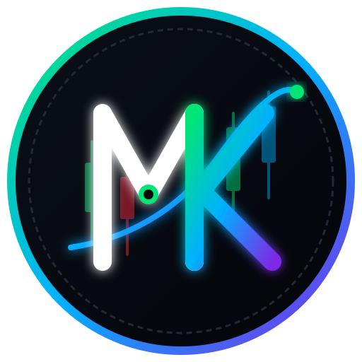

# MK Crypto & Forex - Pro Terminal

<p align="center">
  
</p>

Dashboard institucional en tiempo real para scalping y análisis técnico de Criptomonedas, Forex, Índices y Materias Primas. 

Ejecutado **100% del lado del cliente** en el navegador (HTML5, CSS3, Vanilla JS), con coste cero en APIs de pago y sin consumo de tokens de IA.


## Características Principales

- **Conexión en Tiempo Real Tick a Tick:** WebSockets públicos de Binance multiplexados para las principales criptomonedas (BTC, ETH, SOL, BNB, XRP, PEPE, etc.) con latencia inferior a 100 ms.
- **Gráfico Profesional con Historial Completo (TradingView):** Integración nativa con herramientas de dibujo, todas las temporalidades (1m, 5m, 15m, 1h, etc.) y persistencia de configuración.
- **Heatmap de Liquidaciones y Muros de Órdenes:** Visualización térmica de alta densidad (120 niveles verticales x 80 columnas de tiempo) estilo *The Kingfisher / Coinglass*, con escala dinámica y micro-velas superpuestas.
- **Motor de Confluencia Multi-Estrategia:**
  - RSI Extremo en temporalidades bajas (5m / 15m).
  - Divergencias regulares de momentum.
  - Filtro de tendencia con Medias Móviles (EMA Ribbon 9/21/50).
  - Barrido de liquidez (*Liquidity Sweep*).
  - Absorción de volumen institucional.
- **Plan de Trading Automático:** Sugerencia inmediata de Entrada, Stop Loss (SL) y Take Profit (TP1 1:2 y TP2 1:3).
- **Asistente de Voz Institucional en Español:**
  - Selección de voces naturales/neuronales del sistema.
  - Modo inteligente anti-repetición (anuncia solo ante cambios de señal o intervalos configurables).
  - Botón de reproducción manual bajo demanda.
- **Compatibilidad Amplia:** Criptos, Forex (EUR/USD, GBP/USD, USD/JPY, etc.), Oro (XAU/USD), Petróleo e Índices (S&P 500, NASDAQ, Dow Jones).

## Cómo Usar

1. Clona o descarga este repositorio:
   ```bash
   git clone https://github.com/marcomondino84/forex_crypto.git
   ```
2. Abre `index.html` directamente en cualquier navegador moderno (Chrome, Edge, Firefox, Brave) o alójalo en tu servidor web (XAMPP, Apache, Nginx, GitHub Pages). No requiere bases de datos ni backend adicional.

